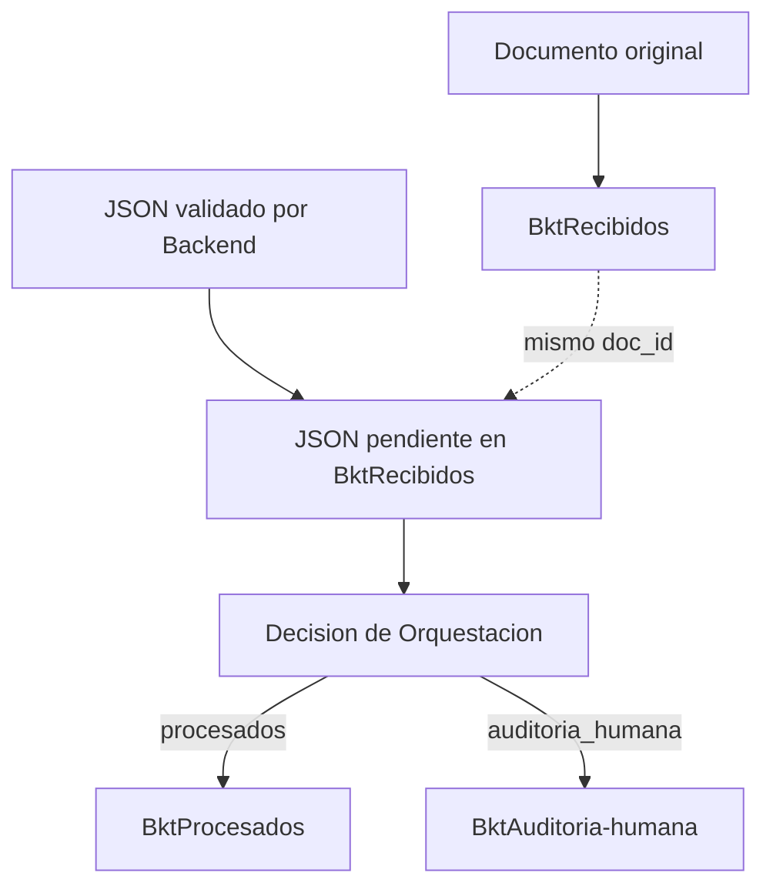

# MediFlow — OCI Object Storage

El módulo `oci_storage.py` guarda documentos originales, persiste su JSON estructurado y mueve ese JSON al destino que indique Backend. Está incorporado junto a `main.py`; falta conectar las llamadas al endpoint y al pipeline real.

## Configuración

Entorno usado para verificar el módulo: Python 3.11 y `oci==2.187.0`. La dependencia OCI está incluida en el `requirements.txt` de esta carpeta. Desde la raíz del repositorio, instalar las dependencias en el entorno Python del backend:

```powershell
python -m pip install -r Backend_FastAPI/requirements.txt
```

Configurar un perfil OCI válido en `~/.oci/config` con su clave local. Seleccionar el perfil antes de iniciar la API o importar el módulo:

```powershell
$env:OCI_PROFILE = "Hackaton"
```

`Hackaton` es el perfil usado en la PC de Raúl. En otra máquina puede tener otro nombre. Si no se define `OCI_PROFILE`, el módulo selecciona `DEFAULT`. En la PC de Raúl, `DEFAULT` apunta a una clave antigua y debe usarse `Hackaton`.

| Configuración del entorno comprobado | Valor |
|---|---|
| Región | `sa-saopaulo-1` |
| Namespace | `gru7yrmaafak` |
| Compartimento | `mediflow-hackathon` |
| Originales y JSON pendientes | `BktRecibidos` |
| Resultados procesados | `BktProcesados` |
| Resultados para revisión humana | `BktAuditoria-humana` |

## Integración

Las siguientes llamadas corresponden a etapas del pipeline; las variables las proporciona Backend:

```python
from oci_storage import (
    subir_documento_crudo,
    subir_json_estructurado,
    enrutar_json_estructurado,
)

original = subir_documento_crudo(contenido_bytes, nombre_original)
# Guardar la referencia original en la base de datos.
pendiente = subir_json_estructurado(datos_validados, original)
# Guardar la referencia pendiente completa, incluido sha256.
final = enrutar_json_estructurado(pendiente, decision_almacenamiento)
# Guardar la referencia final como ubicacion actual.
```

`datos_validados` debe ser un diccionario compatible con JSON, validado por Backend. `decision_almacenamiento` admite exactamente `procesados` o `auditoria_humana`. Orquestación define esa decisión; el módulo no calcula scores ni reglas clínicas.



El original se guarda en `AAAA/MM/DD/<doc_id>_<nombre>`. El JSON usa `estructurados/AAAA/MM/DD/<doc_id>.json`, con la fecha UTC del original, y mantiene el nombre cuando cambia de bucket. Su referencia incluye el UUID, la ubicación, el tamaño, el estado, la referencia al original y la huella `sha256`.

## Errores y reintentos

El movimiento comprueba el contenido y los metadatos de la copia final antes de retirar el JSON pendiente. Usa el ETag del origen para impedir borrar una versión que cambió durante la operación. El original crudo se conserva.

Si la operación falla, se propaga la excepción. Backend debe guardar la referencia pendiente antes de mover y usar esa misma referencia y decisión para reintentar. Si queda una copia final idéntica, el reintento puede completar el retiro del pendiente. Un resultado diferente en destino provoca un conflicto y no se sobrescribe.

Backend debe ejecutar una sola operación por `doc_id` a la vez, incluidos los reprocesamientos: el módulo no proporciona una transacción entre buckets ni un bloqueo distribuido. La transición posterior de auditoría a procesado tras una aprobación humana todavía requiere integración con el equipo HITL.

Las funciones son síncronas. El endpoint actual de FastAPI es asíncrono; la integración debe ejecutar estas operaciones mediante el mecanismo de trabajo en hilos del framework para evitar bloquear otras solicitudes. Las pruebas del módulo no verifican aún el endpoint real.

## Logging y permisos

`mediflow_oci.log` se crea en el directorio desde el que se ejecuta el proceso. También se escribe en consola. Se registran subidas, guardado del JSON, movimientos y errores. El cuerpo del JSON no se registra.

Para el flujo completo, el perfil requiere lectura en los tres buckets, escritura en los buckets usados y eliminación del JSON pendiente en `BktRecibidos`. Las claves `.pem`, la carpeta `.oci` y el log están excluidos por el `.gitignore` del repositorio.

## Pruebas locales

Desde la raíz del repositorio:

```powershell
python -m unittest discover -s Backend_FastAPI -p "test_*.py" -v
```

Los dos archivos de pruebas contienen 22 casos y simulan OCI: no requieren credenciales ni hacen escrituras remotas. Comprueban serialización, trazabilidad, decisiones, fallos y recuperación.

Las pruebas remotas previas usaron tres casos ficticios y decisiones simuladas: rutina y urgencia en procesados, ambigüedad en auditoría. Esa comprobación valida el almacenamiento; la clasificación, extracción, decisiones clínicas y panel humano deben probarse con el pipeline completo del equipo.
