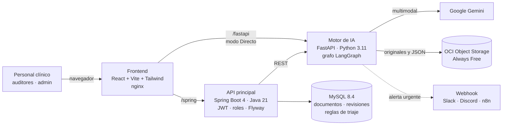
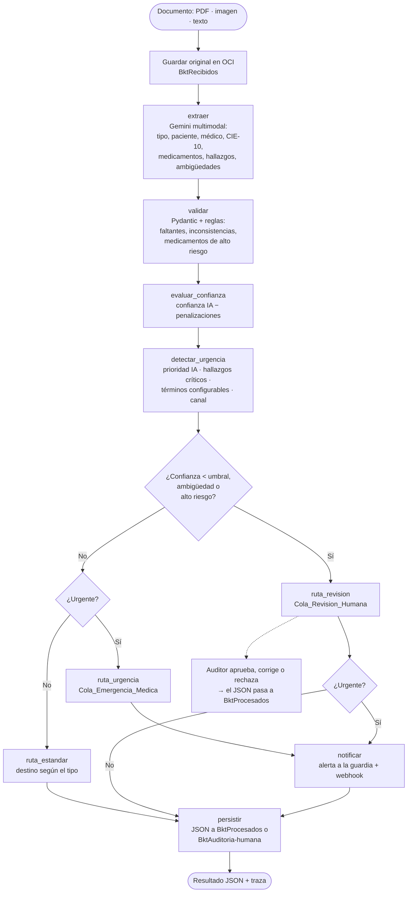

# 🏥 MediFlow — Agente autónomo de triaje clínico

**Hackathon ONE G10 — Oracle Next Education & Alura · Equipo 13 LATAM**

MediFlow recibe documentos clínicos (PDF, imágenes escaneadas, fotos o texto), los **clasifica** con IA multimodal,
**extrae** los datos clínicos, **evalúa la confianza** y la **urgencia** con reglas explícitas y los **enruta** al
departamento correcto mediante un **grafo de decisión (LangGraph)**. Los casos dudosos van a **revisión humana**
(Human-in-the-Loop), los urgentes **alertan a la guardia** y todo queda guardado en **OCI Object Storage**.

| Escenario | Qué hace el agente | Destino |
|---|---|---|
| 🟢 **Rutina** — receta legible y completa | Clasifica, extrae medicamentos y dosis, confianza alta | `Farmacia_Hospitalaria` |
| 🔴 **Urgencia** — informe con TEP agudo | Detecta el hallazgo crítico, genera la alerta y notifica | `Cola_Emergencia_Medica` |
| 🟡 **Ambiguo** — orden ilegible e incompleta | Penaliza la confianza por datos faltantes y la deriva | `Cola_Revision_Humana` → auditor |

---

## Arquitectura



| Componente | Responsabilidad |
|---|---|
| **Frontend** (`mediflow-frontend/`) | Carga de documentos, colas, historial, detalle con la traza del agente, panel de auditoría, usuarios, reglas de triaje y alertas en tiempo real. |
| **API principal** (`Back-End/MediFlow/`) | Autenticación JWT y roles, persistencia de documentos y revisiones, reglas de triaje editables, proxy del archivo original, Swagger. |
| **Motor de IA** (`Backend_FastAPI/`) | Grafo de decisión: extracción con Gemini, validación con Pydantic y reglas clínicas, confianza, urgencia, enrutamiento, alertas y respaldo en OCI. |
| **OCI Object Storage** | `BktRecibidos` (originales y JSON pendiente) · `BktProcesados` · `BktAuditoria-humana`. |

## Grafo de decisión del agente

El grafo está implementado con **LangGraph** en [`Backend_FastAPI/agente/grafo.py`](Backend_FastAPI/agente/grafo.py)
y el diagrama Mermaid se puede obtener del propio código en `GET /grafo`. La IA **extrae**; las **reglas deciden**,
de forma determinista y explicable ([`agente/reglas.py`](Backend_FastAPI/agente/reglas.py)).



Cada nodo deja un paso en la **traza** (qué observó, qué decidió, por qué y cuánto tardó). La interfaz la muestra
como línea de tiempo en el detalle de cada documento.

**Destinos estándar** (configurables desde la interfaz): Receta → `Farmacia_Hospitalaria` · Orden de Procedimiento →
`Auditoria_Autorizaciones` · Informe de Estudio por Imágenes/Laboratorio, Epicrisis y Certificado Médico →
`Historia_Clinica_Electronica`.

## Cumplimiento del brief

| Requisito (checklist) | Implementación |
|---|---|
| Ingestión de texto, PDF o imagen | `POST /analizar` (multipart) y `POST /analizar-texto` (JSON con el formato del brief); en la API principal, `analyze/file` y `analyze/text` |
| Clasificación con LLM | Gemini multimodal en las 5 categorías (laboratorio incluido en Informes) |
| Extracción en JSON estructurado | Paciente, médico y matrícula, estudio, diagnóstico, CIE-10, **medicamentos con dosis**; validado con **Pydantic** |
| Lógica de decisión condicional | **Grafo LangGraph** con nodos y aristas condicionales; umbral, urgencia y alto riesgo aplicados en código |
| Integración con OCI Object Storage | Original en `BktRecibidos`, JSON enrutado a `BktProcesados` o `BktAuditoria-humana`; la revisión humana mueve el JSON |
| Tres escenarios | Casos de prueba en la interfaz y `GET /demo/{rutina,urgencia,ambiguo}` (sin IA ni OCI) |
| Documentación con diagrama | Este README, Swagger de ambas APIs y READMEs por componente |

| Diferencial | Implementación |
|---|---|
| Flujo clínico personalizable | Pantalla **Configuración**: umbral, términos de urgencia y destinos guardados en la base; el agente los aplica en cada documento |
| OCR y visión multimodal | Gemini lee fotos, escaneos y PDFs |
| Panel de auditoría Human-in-the-Loop | Pantalla **Auditoría**: visor del original, aprobar, corregir o rechazar en un clic |
| Alertas en tiempo real | Campana con avisos en la interfaz y **webhook** opcional (Slack, Discord o n8n) |
| Despliegue en la nube | `docker compose` listo para una VM Always Free de OCI (ver [Despliegue en OCI](#despliegue-en-oci-compute)) |

## Cómo ejecutarlo

### Opción 1 — Todo con Docker Compose (recomendada)

Requisitos: Docker Desktop.

```bash
cp .env.example .env        # en PowerShell: Copy-Item .env.example .env
```

Completa en `.env` al menos `DB_PASSWORD`, `MYSQL_ROOT_PASSWORD`, `JWT_SECRET`, `MEDIFLOW_ADMIN_PASSWORD` y
`GEMINI_API_KEY`. Para OCI, define `OCI_CONFIG_DIR` con la carpeta que contiene `config` y la clave privada.

```bash
docker compose up -d --build
```

| Servicio | URL |
|---|---|
| Aplicación | http://localhost:3000 |
| API principal (Swagger) | http://localhost:8088/swagger-ui.html |
| Motor de IA (Swagger) | http://localhost:8002/docs |

Entra con el usuario de `MEDIFLOW_ADMIN_USER` / `MEDIFLOW_ADMIN_PASSWORD`: se crea solo en el primer arranque.
Las cuentas nuevas quedan como `NO_ASIGNADO` hasta que un administrador les asigna un rol en **Usuarios y roles**.

### Opción 2 — Desarrollo del frontend con los backends en Docker

```bash
docker compose up -d mysql fastapi backend
cd mediflow-frontend
npm install
npm run dev                 # http://localhost:5173 (proxy a :8088 y :8002)
```

## Probar los tres escenarios

1. En **Procesar documento → Casos de prueba**, procesa los tres casos sintéticos en modo **Persistente**.
2. Revisa **Colas**: cada documento aparece en su destino; el urgente dispara la campana de alertas.
3. Abre un documento → pestaña **Decisión del agente** para ver la traza del grafo.
4. En **Auditoría humana**, aprueba o corrige el caso ambiguo: sale de la cola de revisión hacia su destino.

Sin clave de Gemini, el grafo se puede ver funcionando con respuestas de IA simuladas:

```bash
curl http://localhost:8002/demo/urgencia
```

Con IA real, el formato de entrada del brief:

```bash
curl -X POST http://localhost:8002/analizar-texto -H "Content-Type: application/json" -d '{
  "documento_id": "DOC-CLIN-2026-8942", "tipo_archivo": "PDF", "canal_origen": "Guardia_Emergencias",
  "documento_texto": "HOSPITAL SANTA LUCIA - INFORME DE ESTUDIO RADIOLOGICO. Paciente: Carlos Eduardo Mendes, 52 anos. Medico Solicitante: Dra. Renata Silveira MP 145892. Estudio: Tomografia de Torax con contraste. Hallazgos: Defecto de llenado compatible con TEP agudo. CONCLUSION: Tromboembolismo Pulmonar Agudo."
}'
```

> Usa solo documentos con datos inventados: los archivos se envían a un servicio externo de IA.

## API

**API principal (Spring Boot)** — JWT en `Authorization: Bearer <token>`. Documentación completa en `/swagger-ui.html`.

| Método y ruta | Rol | Descripción |
|---|---|---|
| `POST /api/auth/login` · `GET /api/auth/me` | público · sesión | Token JWT y usuario con su rol vigente |
| `POST /api/user/register` | público | Crea una cuenta `NO_ASIGNADO` |
| `POST /api/documentos/analyze/file` · `analyze/text` | ADMIN, PERSONAL, AUDITOR | Ejecuta el agente y guarda el resultado |
| `GET /api/documentos/findall` · `findbyid/{id}` | ADMIN, PERSONAL, AUDITOR | Historial y detalle (con traza y validación) |
| `PATCH /api/documentos/{id}/revision` | ADMIN, AUDITOR | Aprobar, corregir o rechazar (Human-in-the-Loop) |
| `GET /api/documentos/{id}/archivo` | ADMIN, PERSONAL, AUDITOR | Archivo original desde OCI |
| `GET /api/documentos/alertas` | ADMIN, PERSONAL, AUDITOR | Casos urgentes recientes |
| `GET` · `PUT /api/configuracion` | todos · ADMIN | Reglas de triaje que aplica el agente |
| `GET /api/user/findAll` · `PATCH /api/user/{id}/rol/{rol}` | ADMIN | Gestión de usuarios y roles |

**Motor de IA (FastAPI)** — documentación en `/docs`.

| Método y ruta | Descripción |
|---|---|
| `POST /analizar` | Archivo (PDF, imagen o texto) + `canal_origen` y `config` opcionales |
| `POST /analizar-texto` | JSON con el formato del brief |
| `GET /demo/{escenario}` | Recorre el grafo real con IA simulada |
| `GET /grafo` · `GET /reglas` · `GET /salud` | Diagrama del grafo, reglas por defecto y estado de la configuración |
| `GET /documentos/original` · `POST /documentos/revision` | Original en OCI y cierre del ciclo de revisión en OCI |

## Pruebas

```bash
# Motor de IA: reglas, grafo (3 escenarios), normalizador, API e integración con OCI simulada
cd Backend_FastAPI && pip install -r requirements.txt -r requirements-dev.txt && pytest -q

# API principal: servicios, mapper y cliente de IA (sin base de datos)
cd Back-End/MediFlow && ./mvnw test

# Frontend
cd mediflow-frontend && npm run typecheck && npm run build
```

## Despliegue en la nube (Vercel + Railway)

Frontend en Vercel y backend (Spring, FastAPI y MySQL) en Railway, con solo Spring expuesto a internet.
Paso a paso, variables y conexión entre ambos en [`DESPLIEGUE.md`](./DESPLIEGUE.md).

## Despliegue en OCI Compute

1. Crea una VM Always Free (Ampere A1 o E2.1.Micro) con Ubuntu e instala Docker.
2. Clona el repositorio, crea `.env` y copia la carpeta de configuración de OCI fuera del repositorio.
3. `docker compose up -d --build` y abre el puerto 3000 (o un 80/443 con proxy) en la Security List de la VCN.

## Estructura del repositorio

```
├── docker-compose.yml        Orquestación de los 4 servicios
├── .env.example              Variables (sin secretos)
├── mediflow-frontend/        React 18 + TypeScript + Vite + Tailwind (nginx en producción)
├── Back-End/MediFlow/        Spring Boot 4 · Java 21 · MySQL · Flyway · JWT · springdoc
├── Backend_FastAPI/
│   ├── main.py               API del motor de IA
│   ├── agente/               grafo.py (LangGraph), reglas.py, escenarios_demo.py
│   ├── clasificador/         Cliente de Gemini y normalización de su respuesta
│   ├── oci_storage.py        OCI Object Storage (buckets, enrutamiento, revisión)
│   ├── notificaciones.py     Alertas por webhook
│   └── tests/                pytest
└── infra/                    Carpeta vacía para cuando no hay OCI configurado
```

## Seguridad y privacidad

- Secretos solo en `.env` (fuera de Git). Ninguna imagen incluye credenciales.
- Contraseñas con BCrypt, sesión JWT de 24 h, permisos por rol en cada endpoint.
- Los logs no registran contenido clínico (solo identificadores, tipo y confianza).
- El archivo subido a Gemini se borra al terminar el análisis.
- El webhook de alertas no envía el nombre del paciente salvo que se habilite explícitamente.
- La confianza es una estimación de la IA ajustada por reglas, no una probabilidad calibrada: por eso existe la revisión humana.

## Equipo

Equipo 13 de la Hackathon ONE G10 (No Country). Contribuciones registradas en el historial de Git: JM29R,
VaneMarimar, RodrigoM2025, Cristian Rios Rivas, Juan Manuel Rios, Victor Marin y Juan Coñoman Peralta.
